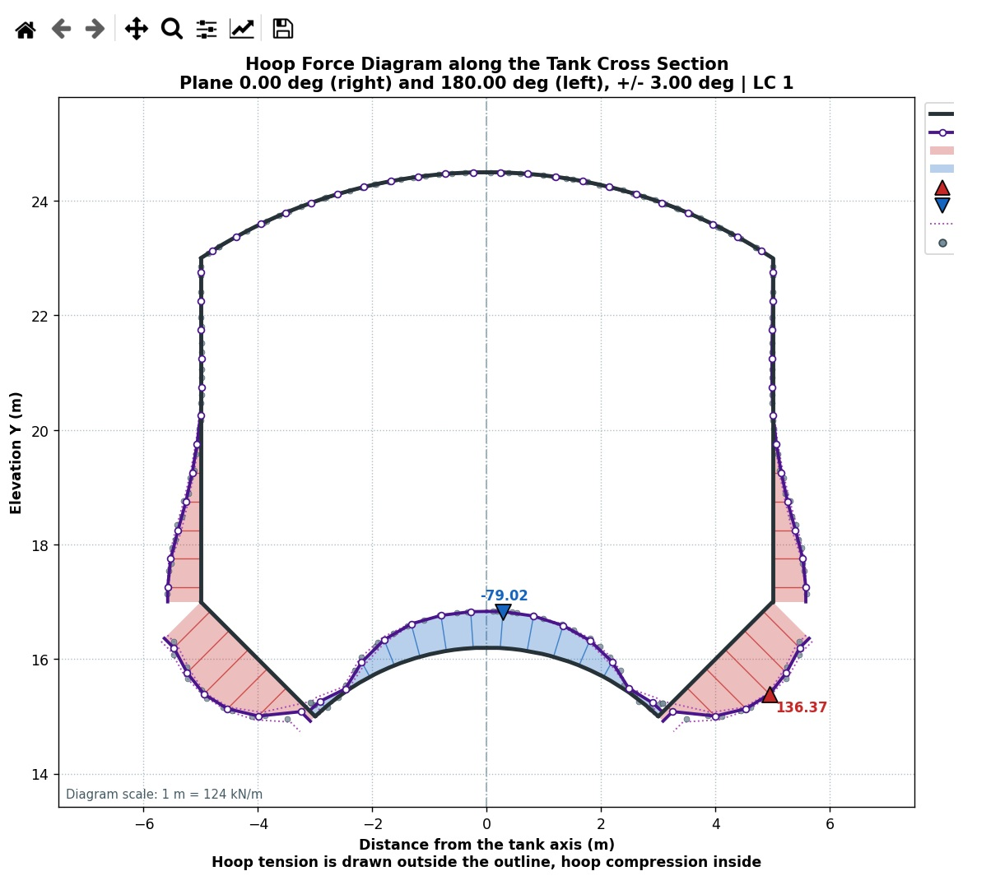
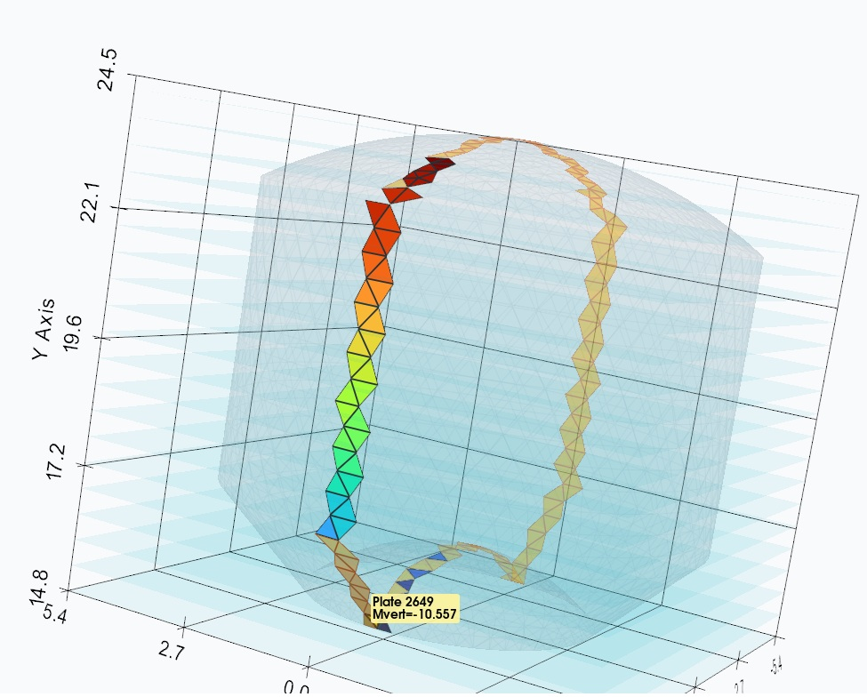
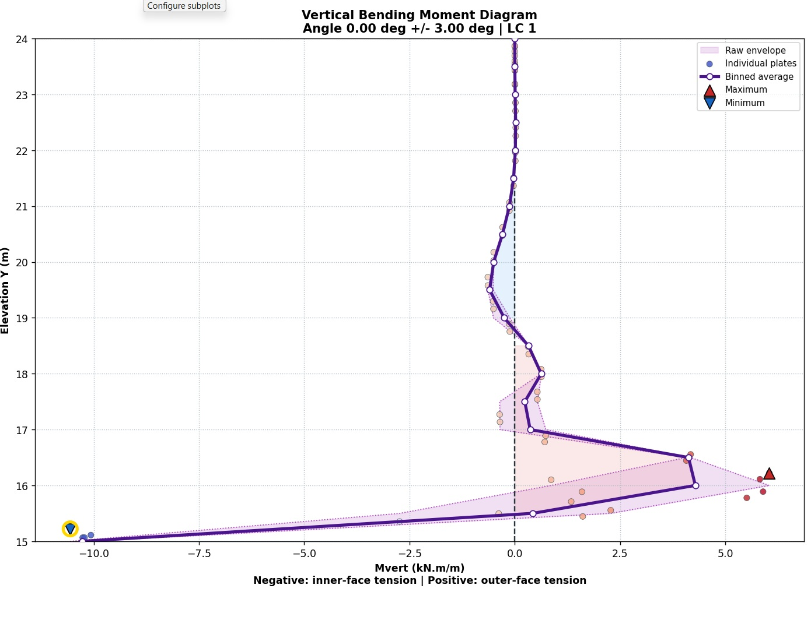

# STAAD Tank Wall Explorer

**Vertical bending moment and hoop force post-processor for circular water tanks in STAAD.Pro (Python + OpenSTAAD)**



---

## 1. Overview

Circular and Intze-type water tanks are usually modelled in STAAD.Pro with plate elements, often with a triangular or unstructured mesh. STAAD reports plate results in each plate's **local axis system**: `Mx`, `My`, `Mxy`, `SX`, `SY` and `SXY`. On a curved, meshed shell, every plate has a different local axis orientation, so these values **cannot be read directly** as the vertical bending moment or the hoop force needed for design.

**STAAD Tank Wall Explorer** connects to the open, analysed STAAD model and:

1. reads the plate geometry, thickness and centre results through OpenSTAAD;
2. transforms each plate's local results into the **vertical (meridional)** and **circumferential (hoop)** directions;
3. groups the plates by elevation and plots clean design diagrams;
4. draws the **bending moment and hoop force around the full tank cross section** (top dome, wall, cone and bottom dome);
5. exports all the numbers to Excel for reinforcement design.

The tool was built for the TORQ YouTube tutorial on post-processing circular water tanks in STAAD.Pro.

---

## 2. Features

| Feature | Description |
|---|---|
| **Result type** | Vertical bending moment (kN·m/m) or hoop force (kN/m) |
| **Any load case or combination** | Pick LC 1 to LC 20 from the list, or type any number (e.g. 101, 201). The number is checked against the model. |
| **Strip selection** | Plane angle ± angular tolerance and bottom/top elevation select a vertical strip of plates |
| **Elevation bins** | Plates are grouped into horizontal bands to give one smooth diagram |
| **Representations** | Bin average, envelope (min/max), raw plates, or raw + average |
| **Tank cross section** | BMD or hoop force drawn along the full meridian on both sides of a cut through the tank centre, with optional values |
| **3D view** | The whole tank with the selected plates highlighted and coloured by result (PyVista) |
| **Plate table** | Plate number, centroid, local results and transformed result for every selected plate |
| **Calculation report** | Step-by-step transformation for each plate, useful for hand checks |
| **Export** | Save diagrams as PNG, and export to Excel (plates, bins, cross-section stations and charts) |

---

## 3. Theory

### 3.1 Local to global moment (Mohr's circle transformation)

For each plate, the angle θ between the plate's local x axis and the global vertical direction (projected onto the plate) is found. The plate moments are then rotated to that direction:

$$
M_{vert} = \frac{M_x + M_y}{2} + \frac{M_x - M_y}{2}\cos 2\theta + M_{xy}\sin 2\theta
$$

This is the same transformation used for stresses in Mohr's circle. It includes the twisting moment `Mxy`, which is often ignored when people read `Mx` or `My` directly.

### 3.2 Hoop force

The in-plane stresses are rotated to the horizontal tangent (circumferential) direction at the plate centroid and multiplied by the plate thickness:

$$
\sigma_{\alpha} = \frac{S_x + S_y}{2} + \frac{S_x - S_y}{2}\cos 2\alpha + S_{xy}\sin 2\alpha
$$

$$
N_{hoop} = \sigma_{\alpha} \times t \quad (\text{kN/m})
$$

Positive is tension. The required hoop steel is then simply \(A_{st} = N_{hoop} / \sigma_{st}\).

### 3.3 Elevation bins



STAAD gives a separate value for every plate, so at any elevation there are several slightly different results. The wall height is divided into equal **bins** (horizontal bands). Each plate is assigned to the bin containing its centre, and the bin **average** becomes one point of the diagram. The **minimum and maximum** in each bin show the scatter (envelope).

**Choosing the bin size:** use roughly the plate height, so that each bin holds one row of plates.
- A bin that is too large averages several rows and flattens the peak moment near the base.
- A bin that is too small leaves some bins empty.

### 3.4 Cross section

The tool takes plates on both sides of the cutting plane (plane angle and plane angle + 180°), builds the tank outline from the plate nodes, and splits it into parts at the dome, wall and cone junctions. The results are then binned along the outline.
- **Moments** are drawn on the **tension face**.
- **Hoop tension** is drawn **outside** the outline.

---

## 4. Example output

### Vertical bending moment along the wall



### Full tank cross section

See the image at the top of this page.

---

## 5. Requirements

- Windows
- **STAAD.Pro** (CONNECT Edition / 2023 or later) with OpenSTAAD Python support
- Python 3.10 or later

### Installation (step by step)

1. **Install Python 3.10 or later** from [python.org](https://www.python.org/downloads/). During setup, tick **"Add python.exe to PATH"**.
2. **Download this repository**: click the green **Code** button → **Download ZIP**, then extract it (for example to `C:\Tools\Circular-Water-Tank-Design-_STAAD`).
   Or, with Git: `git clone https://github.com/biswatoshpurkayastha/Circular-Water-Tank-Design-_STAAD.git`
3. **Open PowerShell in that folder**: open the extracted folder in File Explorer, click the address bar, type `powershell` and press **Enter**.
4. **Install the required Python libraries** (one time only):
   ```bash
   pip install -r requirements.txt
   ```
   If `pip` is not recognised, use `python -m pip install -r requirements.txt`.
5. **Check the installation** (optional):
   ```bash
   python -c "import openstaadpy, PySide6, pyvista; print('All libraries installed')"
   ```
6. **Open STAAD.Pro** and then run the tool from the same PowerShell window:
   ```bash
   python STAAD_Tank_Wall_Explorer.py
   ```

### Python libraries used

| Library | Purpose in this tool |
|---|---|
| [`openstaadpy`](https://pypi.org/project/openstaadpy/) | OpenSTAAD Python API: connects to the open STAAD.Pro model and reads nodes, plates, thickness, load cases and plate results |
| [`pywin32`](https://pypi.org/project/pywin32/) (`pythoncom`) | Initialises COM in the background worker thread so OpenSTAAD can be called without freezing the window |
| [`numpy`](https://numpy.org/) | Vector maths: plate local axes, angle calculations, the Mohr's circle transformation, binning and statistics |
| [`PySide6`](https://doc.qt.io/qtforpython/) | Qt desktop interface: input panel, tabs, tables, buttons and the background extraction thread |
| [`matplotlib`](https://matplotlib.org/) | Interactive elevation diagram and tank cross-section diagram, with hover values and PNG export |
| [`pyvista`](https://pyvista.org/) | 3D mesh of the whole tank, with the selected plates coloured by result and the bin planes and labels |
| [`pyvistaqt`](https://qtdocs.pyvista.org/) | Embeds the PyVista 3D view inside the PySide6 window (rotate, zoom, pan) |
| [`openpyxl`](https://openpyxl.readthedocs.io/) | Excel export: plate data, bins, cross-section stations and native Excel charts (optional; the tool still runs without it) |

Standard library: `sys`, `math`, `traceback` and `collections`.

---

## 6. How to use

1. Open the tank model in STAAD.Pro and **run the analysis**. Keep the model open.
2. Run the tool:
   ```bash
   python STAAD_Tank_Wall_Explorer.py
   ```
3. Set the inputs:

   | Input | Meaning |
   |---|---|
   | Result Type | Vertical bending moment or hoop force |
   | Bottom / Top Elevation Y (m) | Elevation range of the wall to report |
   | Load Case / Combination | Load case or combination number from your model |
   | Plane Angle (deg) | Direction of the vertical strip or cutting plane, measured in plan |
   | Angular Tolerance (± deg) | Width of the strip on either side of the plane |
   | Bin Size (m) | Height of each elevation band (about the plate height) |

4. Click **EXTRACT AND DISPLAY FULL TANK**.
5. Review the tabs:
   - **Interactive Diagram**: BMD or hoop force against elevation (hover to see values)
   - **Tank Cross Section**: diagram around the full section (tick *Show Values on Diagrams* to label it)
   - **Full Tank + Highlighted Plates**: 3D view
   - **Selected Plate Table**
   - **Calculation Report**
6. Click **SAVE DIAGRAM** or **EXPORT TO EXCEL**.

---

## 7. Model assumptions and sign conventions

- Global **Y is vertical**, and the tank axis passes through **X = 0, Z = 0**.
- Units are metres and kN.
- A positive plate moment means tension on the plate's local **+Z** face. In the cross section, the tool converts this to inner or outer face tension automatically.
- Hoop force: positive is tension, negative is compression.

---

## 8. Limitations

- **Ring beams** are frame members, so their hoop tension is not included in the plate results. Check them separately.
- With an unstructured mesh, bins near a dome crown may contain only 1–3 plates, which can give small differences between the two sides of the section.
- Results are taken at plate centres. Peak values right at a junction may be slightly higher than those shown.
- The tool post-processes results; it does not design reinforcement. **Always verify the results** with hand calculations and your design code (e.g. IS 3370) before use.

---

## 9. Troubleshooting

| Problem | Fix |
|---|---|
| "openstaadpy is missing" | Run `pip install openstaadpy` |
| "No analysis results found" | Run the analysis in STAAD.Pro, keep the model open, then extract again |
| "Load case / combination … does not exist" | Pick a number from the list shown in the message |
| "No plates matched the selected plane" | Check the elevation range and increase the angular tolerance |
| Empty bins or gaps | Increase the bin size to about the plate height |

---

## 10. Video tutorial

Watch the full walkthrough on the **TORQ | Simplifying Engineering** YouTube channel:

[](https://www.youtube.com/watch?v=At-iny_ectc)

▶️ **[Watch on YouTube](https://www.youtube.com/watch?v=At-iny_ectc)**

---

## Author

**Biswatosh**, Bentley Systems
YouTube channel: **[TORQ | Simplifying Engineering](https://www.youtube.com/watch?v=At-iny_ectc)**

## License

MIT, see [LICENSE](LICENSE).
